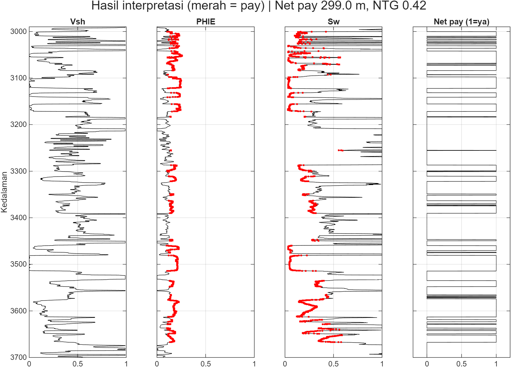
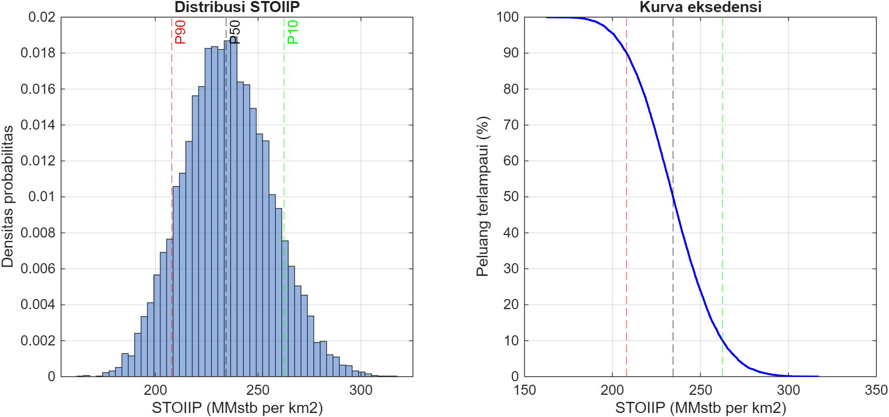
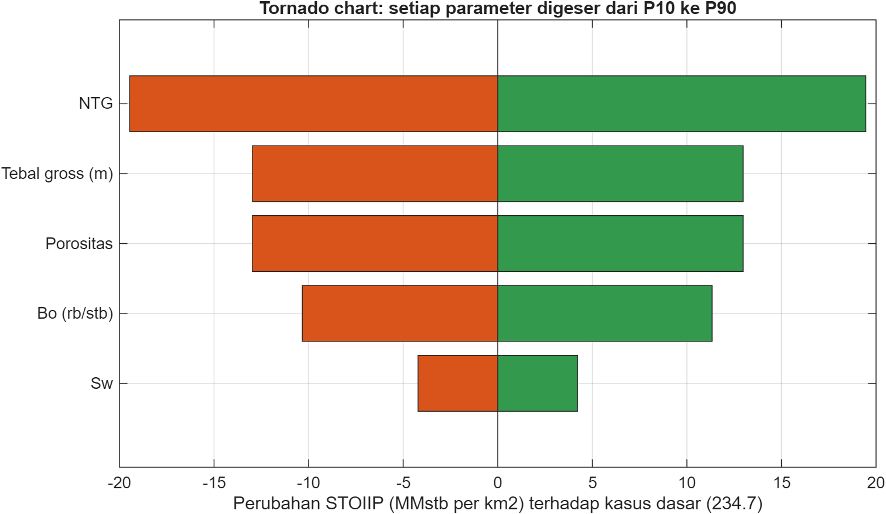

# Petrofisika dan Estimasi Volumetrik Probabilistik: Sumur 15/9-F-14 (Volve)

Proyek latihan dengan data publik untuk menunjukkan alur kerja subsurface dasar:
evaluasi formasi dari log sumur, penentuan net pay, dan estimasi volume
hidrokarbon per satuan area dengan simulasi Monte Carlo.

> Ini proyek pembelajaran dengan data terbuka, **bukan** studi lapangan operasional.

## Hasil Utama (interval 2990-3700 m MD)
| Parameter | Nilai |
|---|---|
| Gross (sepanjang lubang) | 710 m |
| Net pay | 299,0 m |
| NTG | 0,42 |
| Porositas efektif rata-rata (pay) | 0,182 |
| Sw rata-rata (pay) | 0,178 |
| STOIIP per km2, P90 / P50 / P10 | 208 / 234 / 263 MMstb/km2 |
| Uji sensitivitas garis dasar lempung (GR shale = 100 API) | NTG [0.78], P50 [413.8] MMstb/km2 |

## Data
Equinor Volve Open Data, sumur 15/9-F-14 (file LAS, kurva GR, RDEP, DEN, NEU).
Sumber dan lisensi: https://www.equinor.com/energy/volve-data-sharing. Data mentah tidak disertakan di repo ini.

## Metode
1. **Pra-pemrosesan:** nilai RDEP > 1000 ohm.m dibatasi (nilai 5000 kemungkinan batas alat);
   median bergerak 11 sampel (~1,7 m) pada GR, Rt, densitas, dan neutron untuk meredam derau.
2. **Vsh:** indeks GR dengan Larionov (batuan tua), garis dasar pasir bersih dan lempung
   pada persentil 5 dan 95 GR di zona (16,1 dan 62,9 API).
3. **Porositas:** rata-rata kuadrat porositas densitas (matriks 2,65 g/cc, fluida 1,0 g/cc)
   dan neutron, lalu PHIE = PHIT x (1 - Vsh).
4. **Sw:** Archie (a = 1, m = 2, n = 2), Rw = 0,05 ohm.m, diperkirakan dari zona berair
   pada 3700-3740 m MD (0.0459).
5. **Cutoff:** Vsh <= 0,40; PHIE >= 0,10; Sw <= 0,60.
6. **Volumetrik:** STOIIP per km2 = h x NTG x phi x (1 - Sw) / Bo, 10.000 iterasi,
   distribusi segitiga. Tornado: setiap parameter digeser P10 ke P90, lainnya di P50.

## Asumsi
- Seluruh interval 2990-3700 m diperlakukan sebagai satu kolom hidrokarbon terhubung.
- Fluida diasumsikan minyak dengan Bo 1,1 / 1,2 / 1,3 rb/stb (asumsi ilustratif).
- Rentang parameter Monte Carlo (+-10 sampai 15% di sekitar nilai dari log) adalah asumsi.
- Area dinormalisasi ke 1 km2 karena satu sumur tidak memberi informasi area.

## Keterbatasan
- **Ketebalan diukur sepanjang lubang (MD), bukan vertikal.** `tvt_factor` = 1,0; bila sumur
  miring, hasil kemungkinan *overestimate*.
- Urutan batang tornado mencerminkan **lebar rentang yang diasumsikan**, bukan sifat reservoir.
- Garis dasar lempung dari persentil dalam zona (tanpa lempung murni) bersifat konservatif;
  NTG sensitif terhadap pilihan ini (lihat uji sensitivitas).
- Neutron pada skala batugamping tidak dikoreksi ke matriks batupasir.
- Archie tidak ideal untuk batupasir berlempung; tanpa data inti, m, n, dan cutoff tidak dikalibrasi.
- Parameter Monte Carlo independen (tanpa korelasi); tidak ada model struktur atau kontak fluida.

## Langkah Lanjutan
Model lempung (Simandoux/Indonesia), sensitivitas terhadap m, n, dan Rw, koreksi ketebalan
vertikal dari survei deviasi, dan pengerjaan ulang Monte Carlo di Python.

## Cara Menjalankan
MATLAB R2019b+. Taruh file LAS di `data/`, atur nama file dan zona di bagian PENGATURAN
`Source_Code/portfolio_main.m`, lalu jalankan dari folder induk.
